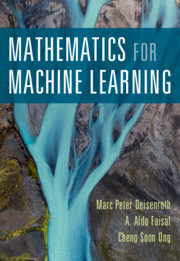

  

# Mathematics for Machine Learning

Personal study notes and worked exercise solutions for *Mathematics for Machine Learning* by **Marc Peter Deisenroth**, **A. Aldo Faisal** and **Cheng Soon Ong**, published by Cambridge University Press (2020).

## About the book

- **Authors:** Marc Peter Deisenroth, A. Aldo Faisal, Cheng Soon Ong (all connected to Imperial College London at the time of writing)
- **Publisher:** Cambridge University Press, 1st edition, 2020
- **ISBN (hardback):** 978-1-108-47004-9
- **Website / free PDF:** [mml-book.github.io](https://mml-book.github.io/) — the pre-publication version is free to view and download for personal use; the published version is © Cambridge University Press

The book is a self-contained introduction to the mathematics that underpins modern machine learning, written to bridge the gap between mathematics textbooks and machine-learning courses. It assumes only basic high-school-level mathematics and develops everything else from scratch.

**Part I — Foundations** covers linear algebra, analytic geometry, matrix decompositions (eigendecomposition, SVD), vector calculus, probability and distributions, and continuous optimization (constrained optimization and Lagrange multipliers). **Part II — Central Machine Learning Problems** then applies the mathematics to machine learning itself: an introduction to the ML pipeline, regression, dimensionality reduction (principal component analysis) and classification (support vector machines). **Part III — Probabilistic Machine Learning (Advanced Topics)** treats latent-variable models, mixture models and the EM algorithm, state space models and Gaussian processes.

Appendices provide a compact reference for the linear algebra, geometry, matrix decomposition, calculus, probability and optimization facts used throughout.

## This repository

Each exercise is worked out as an Obsidian note, with the problem statement and a step-by-step proof. The notes live alongside this README in the vault.
